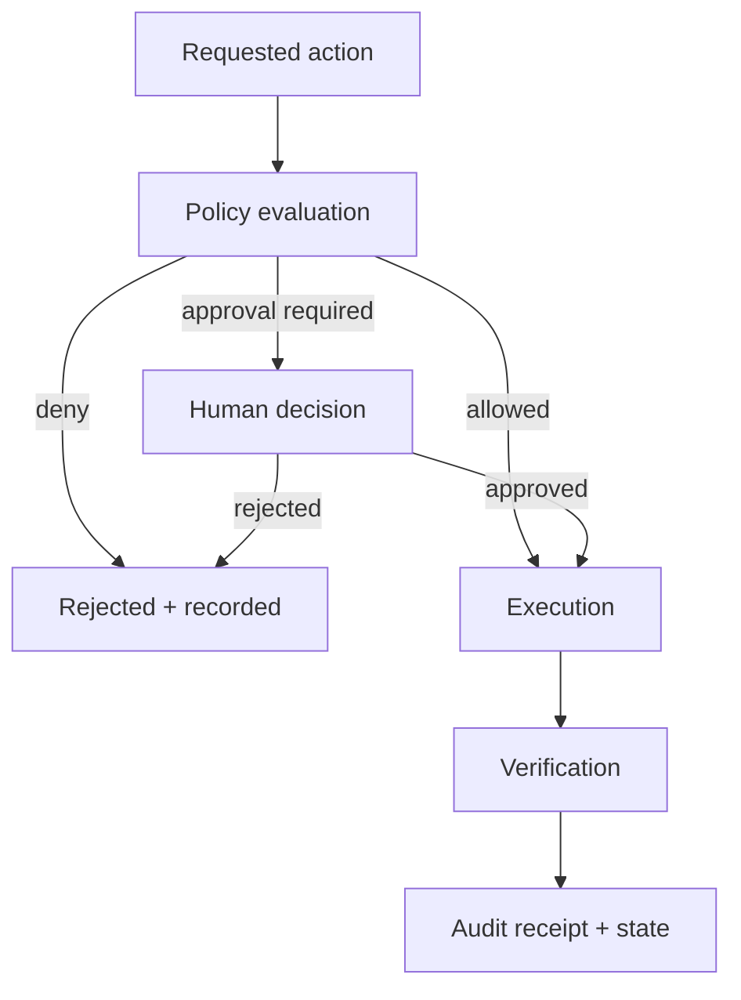

# Governed AI Control Plane

[](https://github.com/lpssovereign/lps_control_plane/actions/workflows/ci.yml)

A compact Python reference implementation for governing AI-agent actions before, during, and after execution.

It demonstrates a practical systems principle:

> Capability is not authority. An agent should not execute a consequential action merely because it can.

## What this repository demonstrates

- explicit execution states: `INIT → PLAN → APPROVE → EXECUTE → VERIFY → COMPLETE`
- policy evaluation before tool execution
- risk-based approval and denial
- append-only, hash-chained audit records
- integrity verification and deterministic state replay
- bounded delegation and standing-authority patterns
- automated tests for state transitions, policy enforcement, and silent-execution prevention

This is the runnable technical anchor for [Lalo Pacheco Sánchez's public AI systems architecture portfolio](https://github.com/lpssovereign/Lalo-Pacheco-Sanchez---Architecture).

## Architecture



The runtime separates five concerns:

| Component | Responsibility |
|---|---|
| `StateMachine` | permits only valid execution-state transitions |
| `PolicyEngine` | evaluates registered rules and returns the most restrictive verdict |
| `ExecutionEngine` | coordinates policy, approval, execution, verification, and result handling |
| `AuditLog` | records hash-linked events and verifies chain integrity |
| Delegation models | express bounded authority without granting universal execution rights |

## Quick start

Requirements: Python 3.10 or newer.

```bash
git clone https://github.com/lpssovereign/lps_control_plane.git
cd lps_control_plane
python -m venv .venv
source .venv/bin/activate
python -m pip install --upgrade pip
pip install -e ".[dev]"
pytest tests/test_state_transitions.py \
       tests/test_policy_enforcement.py \
       tests/test_no_silent_execution.py
python examples/demo_agent_run.py
```

## Minimal example

```python
from control_plane import Action, ExecutionEngine, RiskBasedPolicy

engine = ExecutionEngine()
engine.policy_engine.register_rule(
    RiskBasedPolicy(approval_threshold=7, deny_threshold=10)
)
engine.register_executor("summarize", lambda params: params["text"][:80])

action = Action(
    action_type="summarize",
    params={"text": "A source-backed document to summarize."},
    risk_level=2,
)

result = engine.execute(action, auto_approve=True)

print(result.success)
print(engine.audit_log.verify_integrity())
```

## Evidence map

| Claim | Inspect |
|---|---|
| Invalid transitions are blocked | [state-machine tests](tests/test_state_transitions.py) |
| Policies can allow, deny, or require approval | [policy tests](tests/test_policy_enforcement.py) |
| Execution cannot silently bypass the governed path | [silent-execution tests](tests/test_no_silent_execution.py) |
| Load behavior and invariants can be exercised locally | [stress tests](tests/test_runtime_stress.py) |
| Results are reproducible on the reviewer's machine | [benchmark script](benchmarks/simple_run_benchmark.py) |
| The workflow is visible on every proposed change | [GitHub Actions](.github/workflows/ci.yml) |

## Reproducible benchmarks

Performance depends on hardware, Python version, operating system, and workload. This repository therefore treats benchmark output as local evidence, not a universal performance guarantee.

```bash
python benchmarks/simple_run_benchmark.py
pytest tests/test_runtime_stress.py -v -m stress
```

When citing results, include the commit SHA, environment, command, and raw output.

## Security boundary

This project is a reference implementation, not an audited production security product.

Current limitations include:

- single-process, single-node execution
- in-memory audit storage unless exported by the caller
- hash-chain tamper detection without signer identity or external anchoring
- no distributed consensus or multi-tenant isolation
- a deliberately small policy model rather than a full policy DSL
- example executors rather than hardened production integrations

The code demonstrates governance patterns. Production use would require threat modeling, persistence, authentication, authorization, secrets management, observability, failure recovery, and independent security review.

## Project status

**Maturity: tested reference implementation.**

The core state, policy, audit, delegation, example, and test paths are implemented. Distributed execution, durable persistence, cryptographic signing, and a visual operations surface remain future work.

## Portfolio relevance

This project supports work in:

- AI solutions engineering and implementation
- responsible AI and agent governance
- human-in-the-loop workflow design
- legal-tech and other high-stakes operational systems
- auditable automation and systems integration

For broader case studies—including governed evidence operations, workflow reconciliation, and source-backed guided execution—see the [AI Systems Architecture portfolio](https://github.com/lpssovereign/Lalo-Pacheco-Sanchez---Architecture).

## License

MIT. See [LICENSE](LICENSE).

## Author

**Lalo Pacheco Sánchez**  
AI systems / solutions architecture · governed automation · implementation
